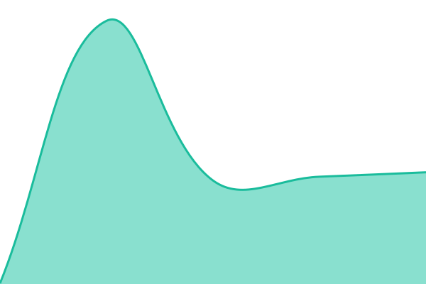
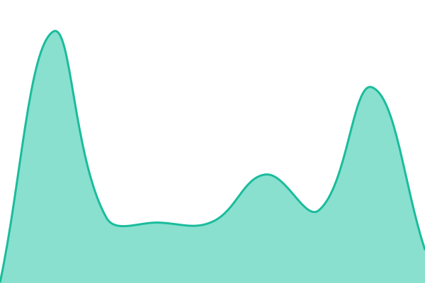
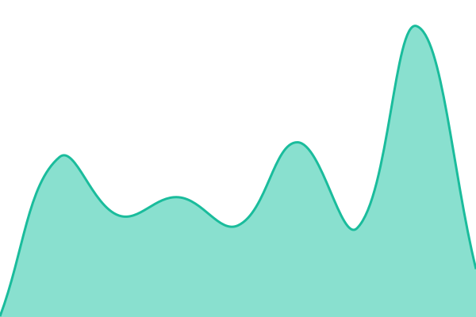
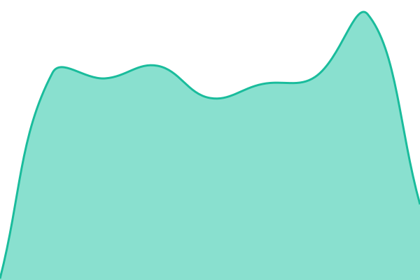
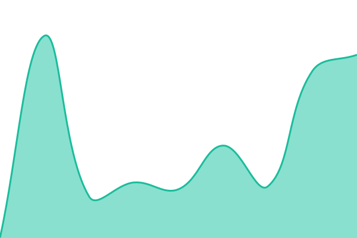
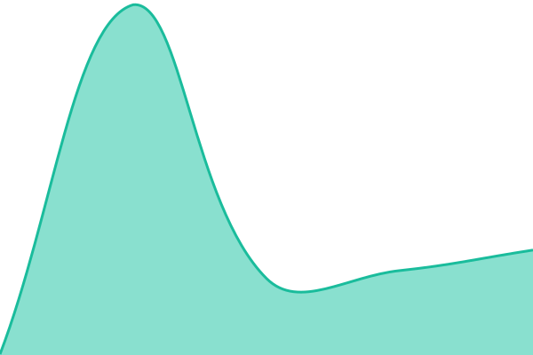
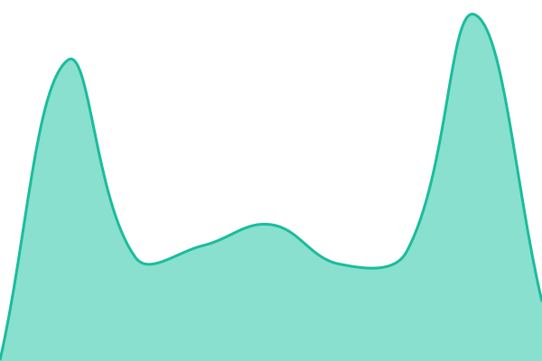
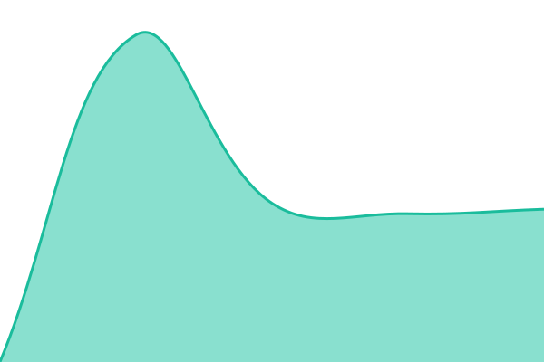

# [📈 Live Status](https://yacineclaudeai.github.io/status): <!--live status--> **🟩 All systems operational**

This repository contains the open-source uptime monitor and status page for [yacineclaudeai](https://yacineclaudeai.github.io/status), powered by [Upptime](https://github.com/upptime/upptime).

With [Upptime](https://upptime.js.org), you can get your own unlimited and free uptime monitor and status page, powered entirely by a GitHub repository. We use [Issues](https://github.com/yacineclaudeai/status/issues) as incident reports, [Actions](https://github.com/yacineclaudeai/status/actions) as uptime monitors, and [Pages](https://yacineclaudeai.github.io/status) for the status page.

<!--start: status pages-->
<!-- This summary is generated by Upptime (https://github.com/upptime/upptime) -->
<!-- Do not edit this manually, your changes will be overwritten -->
<!-- prettier-ignore -->
| URL | Status | History | Response Time | Uptime |
| --- | ------ | ------- | ------------- | ------ |
|  [ERP (page)](https://erp-yacine.netlify.app/index.html) | 🟩 Up | [erp.yml](https://github.com/yacineclaudeai/status/commits/HEAD/history/erp.yml) | 

 272ms
     
 | 

<a href="https://yacineclaudeai.github.io/status/history/erp">100.00%</a>
    

|  [steptech / djibaflorida](https://steptech.myecomsite.net/djibaflorida) | 🟩 Up | [steptech-djibaflorida.yml](https://github.com/yacineclaudeai/status/commits/HEAD/history/steptech-djibaflorida.yml) | 

 582ms
     
 | 

<a href="https://yacineclaudeai.github.io/status/history/steptech-djibaflorida">100.00%</a>
    

|  [steptech / IiC7](https://steptech.myecomsite.net/IiC7) | 🟩 Up | [steptech-iic7.yml](https://github.com/yacineclaudeai/status/commits/HEAD/history/steptech-iic7.yml) | 

 417ms
     
 | 

<a href="https://yacineclaudeai.github.io/status/history/steptech-iic7">100.00%</a>
    

|  [steptech / pyjamasalopette](https://steptech.myecomsite.net/pyjamasalopette) | 🟩 Up | [steptech-pyjamasalopette.yml](https://github.com/yacineclaudeai/status/commits/HEAD/history/steptech-pyjamasalopette.yml) | 

 533ms
     
 | 

<a href="https://yacineclaudeai.github.io/status/history/steptech-pyjamasalopette">100.00%</a>
    

|  [promochoc / 01Aj](https://www.promochoc.store/01Aj) | 🟩 Up | [promochoc-01aj.yml](https://github.com/yacineclaudeai/status/commits/HEAD/history/promochoc-01aj.yml) | 

 208ms
     
 | 

<a href="https://yacineclaudeai.github.io/status/history/promochoc-01aj">100.00%</a>
    

|  [promochoc / DABDOUB](https://www.promochoc.store/DABDOUB) | 🟩 Up | [promochoc-dabdoub.yml](https://github.com/yacineclaudeai/status/commits/HEAD/history/promochoc-dabdoub.yml) | 

 502ms
     
 | 

<a href="https://yacineclaudeai.github.io/status/history/promochoc-dabdoub">100.00%</a>
    

|  [promochoc / djibakatifa4D](https://www.promochoc.store/djibakatifa4D) | 🟩 Up | [promochoc-djibakatifa4d.yml](https://github.com/yacineclaudeai/status/commits/HEAD/history/promochoc-djibakatifa4d.yml) | 

 136ms
     
 | 

<a href="https://yacineclaudeai.github.io/status/history/promochoc-djibakatifa4d">100.00%</a>
    

|  [promochoc / djibakatifanb](https://www.promochoc.store/djibakatifanb) | 🟩 Up | [promochoc-djibakatifanb.yml](https://github.com/yacineclaudeai/status/commits/HEAD/history/promochoc-djibakatifanb.yml) | 

 227ms
     
 | 

<a href="https://yacineclaudeai.github.io/status/history/promochoc-djibakatifanb">100.00%</a>
    

|  [promochoc / DJIBAKATIFAWOW](https://www.promochoc.store/DJIBAKATIFAWOW) | 🟩 Up | [promochoc-djibakatifawow.yml](https://github.com/yacineclaudeai/status/commits/HEAD/history/promochoc-djibakatifawow.yml) | 

 162ms
     
 | 

<a href="https://yacineclaudeai.github.io/status/history/promochoc-djibakatifawow">100.00%</a>
    

|  [promochoc / etoilepyjamaburbury](https://www.promochoc.store/etoilepyjamaburbury) | 🟩 Up | [promochoc-etoilepyjamaburbury.yml](https://github.com/yacineclaudeai/status/commits/HEAD/history/promochoc-etoilepyjamaburbury.yml) | 

 260ms
     
 | 

<a href="https://yacineclaudeai.github.io/status/history/promochoc-etoilepyjamaburbury">100.00%</a>
    

|  [promochoc / jebbakatifa](https://www.promochoc.store/jebbakatifa) | 🟩 Up | [promochoc-jebbakatifa.yml](https://github.com/yacineclaudeai/status/commits/HEAD/history/promochoc-jebbakatifa.yml) | 

 452ms
     
 | 

<a href="https://yacineclaudeai.github.io/status/history/promochoc-jebbakatifa">100.00%</a>
    

|  [promochoc / NOIRETROUGE](https://www.promochoc.store/NOIRETROUGE) | 🟩 Up | [promochoc-noiretrouge.yml](https://github.com/yacineclaudeai/status/commits/HEAD/history/promochoc-noiretrouge.yml) | 

 132ms
     
 | 

<a href="https://yacineclaudeai.github.io/status/history/promochoc-noiretrouge">100.00%</a>
    

|  [promochoc / packpyjamastitch](https://www.promochoc.store/packpyjamastitch) | 🟩 Up | [promochoc-packpyjamastitch.yml](https://github.com/yacineclaudeai/status/commits/HEAD/history/promochoc-packpyjamastitch.yml) | 

 245ms
     
 | 

<a href="https://yacineclaudeai.github.io/status/history/promochoc-packpyjamastitch">100.00%</a>
    

|  [promochoc / pyjama3pcoton](https://www.promochoc.store/pyjama3pcoton) | 🟩 Up | [promochoc-pyjama3pcoton.yml](https://github.com/yacineclaudeai/status/commits/HEAD/history/promochoc-pyjama3pcoton.yml) | 

 281ms
     
 | 

<a href="https://yacineclaudeai.github.io/status/history/promochoc-pyjama3pcoton">100.00%</a>
    

|  [promochoc / pyjamaarieurimportationmotifcoeur](https://www.promochoc.store/pyjamaarieurimportationmotifcoeur) | 🟩 Up | [promochoc-pyjamaarieurimportationmotifcoeur.yml](https://github.com/yacineclaudeai/status/commits/HEAD/history/promochoc-pyjamaarieurimportationmotifcoeur.yml) | 

 148ms
     
 | 

<a href="https://yacineclaudeai.github.io/status/history/promochoc-pyjamaarieurimportationmotifcoeur">100.00%</a>
    

|  [promochoc / pyjamaautomnecutetroispieces](https://www.promochoc.store/pyjamaautomnecutetroispieces) | 🟩 Up | [promochoc-pyjamaautomnecutetroispieces.yml](https://github.com/yacineclaudeai/status/commits/HEAD/history/promochoc-pyjamaautomnecutetroispieces.yml) | 

 510ms
     
 | 

<a href="https://yacineclaudeai.github.io/status/history/promochoc-pyjamaautomnecutetroispieces">100.00%</a>
    

|  [promochoc / pyjamainspire](https://www.promochoc.store/pyjamainspire) | 🟩 Up | [promochoc-pyjamainspire.yml](https://github.com/yacineclaudeai/status/commits/HEAD/history/promochoc-pyjamainspire.yml) | 

 444ms
     
 | 

<a href="https://yacineclaudeai.github.io/status/history/promochoc-pyjamainspire">100.00%</a>
    

|  [promochoc / pyjamakatifacinqpieces](https://www.promochoc.store/pyjamakatifacinqpieces) | 🟩 Up | [promochoc-pyjamakatifacinqpieces.yml](https://github.com/yacineclaudeai/status/commits/HEAD/history/promochoc-pyjamakatifacinqpieces.yml) | 

 375ms
     
 | 

<a href="https://yacineclaudeai.github.io/status/history/promochoc-pyjamakatifacinqpieces">100.00%</a>
    

|  [promochoc / pyjamanemrihiver](https://www.promochoc.store/pyjamanemrihiver) | 🟩 Up | [promochoc-pyjamanemrihiver.yml](https://github.com/yacineclaudeai/status/commits/HEAD/history/promochoc-pyjamanemrihiver.yml) | 

 126ms
     
 | 

<a href="https://yacineclaudeai.github.io/status/history/promochoc-pyjamanemrihiver">100.00%</a>
    

|  [promochoc / pyjamanoeud](https://www.promochoc.store/pyjamanoeud) | 🟩 Up | [promochoc-pyjamanoeud.yml](https://github.com/yacineclaudeai/status/commits/HEAD/history/promochoc-pyjamanoeud.yml) | 

 153ms
     
 | 

<a href="https://yacineclaudeai.github.io/status/history/promochoc-pyjamanoeud">100.00%</a>
    

|  [promochoc / pyjamapouches](https://www.promochoc.store/pyjamapouches) | 🟩 Up | [promochoc-pyjamapouches.yml](https://github.com/yacineclaudeai/status/commits/HEAD/history/promochoc-pyjamapouches.yml) | 

 129ms
     
 | 

<a href="https://yacineclaudeai.github.io/status/history/promochoc-pyjamapouches">100.00%</a>
    

|  [promochoc / pyjamaserpent](https://www.promochoc.store/pyjamaserpent) | 🟩 Up | [promochoc-pyjamaserpent.yml](https://github.com/yacineclaudeai/status/commits/HEAD/history/promochoc-pyjamaserpent.yml) | 

 130ms
     
 | 

<a href="https://yacineclaudeai.github.io/status/history/promochoc-pyjamaserpent">100.00%</a>
    

|  [promochoc / pyjamavers](https://www.promochoc.store/pyjamavers) | 🟩 Up | [promochoc-pyjamavers.yml](https://github.com/yacineclaudeai/status/commits/HEAD/history/promochoc-pyjamavers.yml) | 

 272ms
     
 | 

<a href="https://yacineclaudeai.github.io/status/history/promochoc-pyjamavers">100.00%</a>
    

|  [promochoc / robenemritendence](https://www.promochoc.store/robenemritendence) | 🟩 Up | [promochoc-robenemritendence.yml](https://github.com/yacineclaudeai/status/commits/HEAD/history/promochoc-robenemritendence.yml) | 

 582ms
     
 | 

<a href="https://yacineclaudeai.github.io/status/history/promochoc-robenemritendence">100.00%</a>
    

|  [promochoc / ropekatifanoir](https://www.promochoc.store/ropekatifanoir) | 🟩 Up | [promochoc-ropekatifanoir.yml](https://github.com/yacineclaudeai/status/commits/HEAD/history/promochoc-ropekatifanoir.yml) | 

 200ms
     
 | 

<a href="https://yacineclaudeai.github.io/status/history/promochoc-ropekatifanoir">100.00%</a>
    

|  [HHD Express (Ecotrack)](https://hhdexpress.ecotrack.dz) | 🟩 Up | [hhd-express.yml](https://github.com/yacineclaudeai/status/commits/HEAD/history/hhd-express.yml) | 

 1807ms
     
 | 

<a href="https://yacineclaudeai.github.io/status/history/hhd-express">100.00%</a>
    

|  [Packers (Ecotrack)](https://packers.ecotrack.dz) | 🟩 Up | [packers.yml](https://github.com/yacineclaudeai/status/commits/HEAD/history/packers.yml) | 

 995ms
     
 | 

<a href="https://yacineclaudeai.github.io/status/history/packers">100.00%</a>
    

|  [DHD](https://platform.dhd-dz.com) | 🟩 Up | [dhd.yml](https://github.com/yacineclaudeai/status/commits/HEAD/history/dhd.yml) | 

 469ms
     
 | 

<a href="https://yacineclaudeai.github.io/status/history/dhd">9.77%</a>
    

|  [My Ecom Delivery](https://ecom-dz.com) | 🟩 Up | [my-ecom.yml](https://github.com/yacineclaudeai/status/commits/HEAD/history/my-ecom.yml) | 

 463ms
     
 | 

<a href="https://yacineclaudeai.github.io/status/history/my-ecom">100.00%</a>
    

<!--end: status pages-->

[**Visit our status website →**](https://yacineclaudeai.github.io/status)

## 📄 License

- Powered by: [Upptime](https://github.com/upptime/upptime)
- Code: [MIT](./LICENSE) © [Anand Chowdhary](https://anandchowdhary.com)
- Data in the `./history` directory: [Open Database License](https://opendatacommons.org/licenses/odbl/1-0/)
